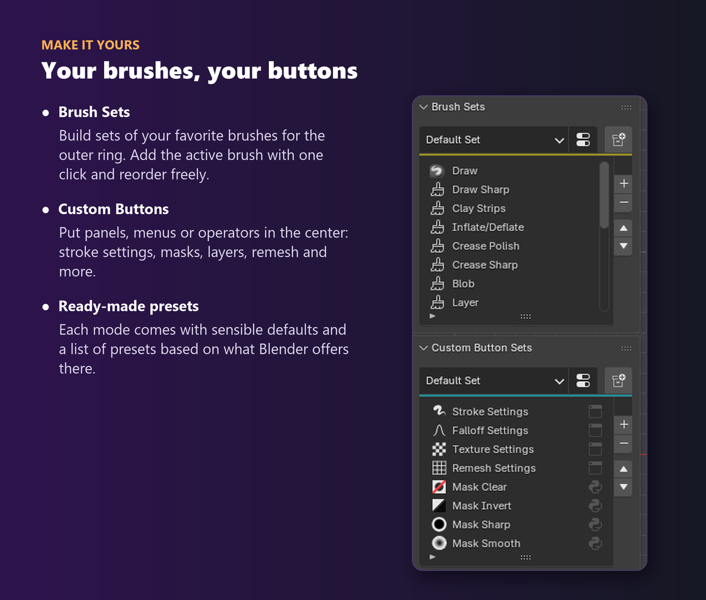
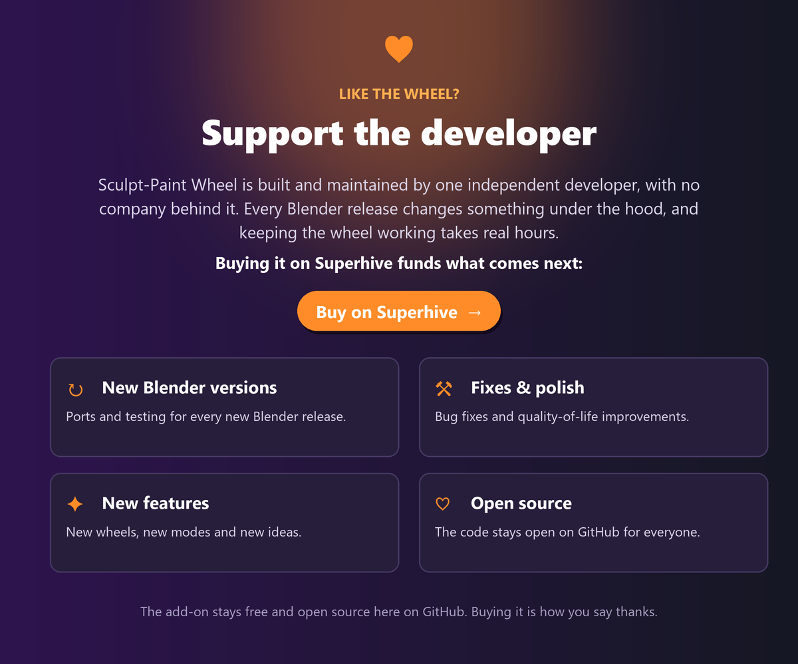

# Sculpt-Paint Wheel: User Guide

The complete guide to Sculpt-Paint Wheel **2.0.0**. For quick answers, see the [FAQ](FAQ.md).

**Contents**

1. [Getting started](#1-getting-started)
2. [The wheel at a glance](#2-the-wheel-at-a-glance)
3. [Controls](#3-controls)
4. [Modes reference](#4-modes-reference)
5. [Brush sets](#5-brush-sets)
6. [Custom buttons](#6-custom-buttons)
7. [Preferences](#7-preferences)
8. [Your data and backups](#8-your-data-and-backups)
9. [Hotkeys and keymap](#9-hotkeys-and-keymap)
10. [Troubleshooting](#10-troubleshooting)

---

## 1. Getting started

### Requirements

- **Blender 5.1 or newer.**
- No internet access is needed. The add-on only reads and writes its own files: its settings, your custom button scripts and your themes.

### Install

1. Download the zip. Don't unzip it.
2. In Blender, go to **Edit › Preferences › Get Extensions**, open the **v** menu at the top right and choose **Install from Disk...**. You can also drag and drop the zip into the Blender window.
3. Check that **Sculpt-Paint Wheel** is enabled under **Edit › Preferences › Add-ons**.

### Update

Install the newer zip the same way. Your brush sets, custom buttons, scripts, themes and preferences are kept.

After an update, each mode's **Default Set** of buttons gets the new default buttons it doesn't have yet, while it has room for them. Default buttons you removed aren't added back. In Sculpt Mode, the new **Default Set (Masking)** is added once, and your active set doesn't change.

### First use

1. Select a mesh and switch to **Sculpt Mode**.
2. Hover the 3D Viewport and **hold `Space`**.
3. Click a brush on the ring, then release `Space`.

The first time you use a mode, a **Default Set** of brushes and buttons is created for it.

---

## 2. The wheel at a glance

The wheel opens centered on your mouse cursor and has these parts:

| Part | What it does |
|---|---|
| **Set name** (top) | The name of the active brush set, for example *Default Set*. Drag it left or right to switch sets. |
| **Brush ring** (outer ring) | The brushes of the active brush set, shown with their Blender previews. The active brush is highlighted. Large sets can use two rings; see [Pages and double ring](#pages-and-double-ring). |
| **Custom buttons** (pie menu) | The buttons of the active custom button set, one segment per button: popups with settings, menus, operators, toggles and scripts. Toggles that are on look pressed. |
| **Center** | Shows the name of what's under the cursor, or the active brush. Drag it to change the brush radius and strength. |
| **Page pill** (bottom) | Shown as `‹ 1 / 2 ›` when the set has more brushes than fit on the ring. Click its arrows to change pages. |
| **Color picker ring** (optional) | Pick the brush color without leaving the wheel. It shows when the active brush paints color, or when you turn it on for the brush set; see [Brush set options](#brush-set-options). |
| **Weight dial** (Weight Paint only) | Replaces the brush ring: a color-coded dial from 0.0 to 1.0 to set the brush weight in one gesture. |
| **Tool buttons** (Weight Paint only) | Small round buttons under the weight dial to switch weight paint tools. |

---

## 3. Controls

| Input | Action |
|---|---|
| Hold `Space` | Open the wheel under the cursor |
| Move the mouse | Highlight a brush or a button. The center shows its name. |
| `Left Click` | Activate the highlighted brush, or run the highlighted button. A button runs when you release the click over it. |
| Drag the center up / down | Change the brush radius |
| Drag the center left / right | Change the brush strength |
| `Mouse Wheel` | Switch brush pages: up for the next page, down for the previous one |
| Click the page pill | Back arrow: previous page. Middle or forward arrow: next page. It wraps around. |
| `Shift` + `Mouse Wheel` | Switch to the next or previous brush set |
| Drag the set name left / right | Switch brush sets |
| Release `Space` | Close the wheel |
| `Esc` / `Right Click` | Cancel and close the wheel |
| `Left Click` outside the wheel | Close the wheel |

### Brush radius and strength

Press in the center of the wheel and drag:

- **Up or down** changes the brush **radius**, one pixel per pixel you move.
- **Left or right** changes the brush **strength**.
- The first few pixels pick the direction, so a drag changes either the radius or the strength, not both.
- Hold `Shift` for finer steps, or `Ctrl` for faster ones.
- The center shows the new value while you drag.
- `Esc` or `Right Click` during the drag puts back the values from before the drag. The wheel stays open.

This works in every wheel, including Weight Paint. Turn it off with **Drag Center: Radius / Strength** in the preferences.

### Behavior preferences

Two preferences change how the wheel closes:

- **Select on Release**: whatever is under the cursor when you release `Space` gets picked, then the wheel closes. Press, move, release: one fluid motion.
- **Keep Open**: releasing `Space` keeps the wheel open, so you can click several things. Press `Space` again to close it.

---

## 4. Modes reference

Each mode has its own wheel, its own brush sets and its own custom button sets. These are the defaults created the first time you use a mode. Brushes come from Blender's built-in **Essentials** library. Buttons marked *(toggle)* show their on/off state.

### Sculpt

- **Brushes (18):** Draw, Draw Sharp, Clay Strips, Inflate/Deflate, Crease Polish, Crease Sharp, Blob, Layer, Fill/Deepen, Flatten/Contrast, Plateau, Scrape Multiplane, Scrape/Fill, Pinch/Magnify, Grab, Grab 2D, Elastic Grab, Pose.
- **Buttons, Default Set (Masking) (10):** Invert Mask, Clear Mask, Smooth Mask, Sharpen Mask, Grow Mask, Shrink Mask, Hide Masked, Show All, Invert Visible, Face Set from Mask. This is the active set the first time.
- **Buttons, Default Set (8):** Stroke Settings, Falloff Settings, Texture Settings, Remesh Settings, Mask Clear, Mask Invert, Mask Sharp, Mask Smooth.

### Texture Paint

- **Brushes (15):** Paint Pixel Art, Erase Pixel Art, Airbrush, Paint Hard, Paint Hard Pressure, Paint Soft, Paint Soft Pressure, Erase Hard, Erase Hard Pressure, Erase Soft, Blur, Smear, Clone, Fill, Mask.
- **Buttons (10):** Advanced Brush Settings, Stroke Settings, Falloff Settings, Texture Settings, Mirror X *(toggle)*, Face Selection Masking *(toggle)*, Save All Images, Add Simple UVs, Texture Slots, Cavity Mask *(toggle)*.

### Vertex Paint

- **Brushes (8):** Paint Soft, Paint Soft Pressure, Paint Hard, Paint Hard Pressure, Airbrush, Blur, Average, Smear.
- **Buttons (10):** Stroke, Falloff, Texture, Symmetry, Paint menu, Smooth Colors, Mirror X *(toggle)*, Face Selection Masking *(toggle)*, Dirty Colors, Invert Colors.

### Weight Paint

- **Weight dial** instead of a brush ring.
- **Tool buttons (8):** Draw, Blur, Average, Smear, Gradient, Sample Weight, Sample Vertex Group, Select Box.
- **Buttons (10):** Brush Settings, Stroke Settings, Falloff Settings, Mirror, Weight Options, Weights menu, Auto Normalize *(toggle)*, Normalize All, Smooth Weights, Clean Weights.

### Sculpt Curves (hair)

- **Brushes (12):** Add, Delete, Density, Comb, Slide, Pinch, Puff, Smooth, Grow/Shrink, Pull Tips, Select, and Cut (Blender 5.3+).
- **Buttons (7):** Brush Settings, Stroke, Falloff, Symmetry, Curves menu, Mirror X *(toggle)*, Snap to Surface.

### Grease Pencil Draw

- **Brushes (13):** Pencil, Pencil Soft, Pen, Ink Pen, Ink Pen Rough, Marker Bold, Marker Chisel, Airbrush, Tint, Fill, Eraser Soft, Eraser Hard, Eraser Stroke.
- **Buttons (8):** Layers, Materials, Stroke, Stabilize Stroke, Advanced, Insert Blank Keyframe, Onion Skin *(toggle)*, Draw on Back *(toggle)*.

### Grease Pencil Sculpt

- **Brushes (9):** Smooth, Thickness, Strength, Randomize, Grab, Pull, Twist, Pinch, Clone.
- **Buttons (6):** Falloff, Auto-Masking, Multi Frame, Layers, Multi-Frame Editing *(toggle)*, Onion Skin *(toggle)*.

### Grease Pencil Weight Paint

- **Weight dial** instead of a brush ring.
- **Tool buttons (4):** Draw, Blur, Average, Smear.
- **Buttons (8):** Options, Falloff, Weights menu, Normalize All, Invert Weight, Smooth Weight, Auto Normalize *(toggle)*, Multi-Frame Editing *(toggle)*.

### Grease Pencil Vertex Paint

- **Brushes (5):** Paint, Blur, Average, Smear, Replace.
- **Buttons (8):** Color, Falloff, Multi Frame, Paint menu, Reset Vertex Color, Invert Colors, Multi-Frame Editing *(toggle)*, Onion Skin *(toggle)*.
- The color picker ring shows with the brushes that paint color (Paint and Replace).

> **Blender 5.3 note:** in Sculpt, Texture, Vertex and Weight Paint, Blender moved brush falloff into the new **Shape** panel. *Falloff* buttons open that panel automatically.

---

## 5. Brush sets

Brush sets control the **outer ring**. Manage them in the 3D Viewport sidebar (`N`), in the **Wheel** tab, under **Brush Sets**. Each mode has its own brush sets, so switch to the mode first.

### Manage sets

- **Switch set:** choose it from the dropdown. In the wheel, drag the set name left or right, or use `Shift` + `Mouse Wheel`.
- **New set:** the button to the right of the dropdown.
- **Rename, options or remove:** the options button next to the dropdown. See [Brush set options](#brush-set-options).

### Manage brushes in a set

1. Activate a brush the usual way, from the toolbar or the asset shelf.
2. Click **+** in the Brush Sets panel to add the **active brush** to the set.
3. Select a brush in the list and click **−** to remove it, or use the arrows to reorder it. The order in the list is the order on the ring.

Any brush asset works, including your own brushes and brushes from other asset libraries.

### Pages and double ring

When a set has more brushes than fit on one ring, the ring shows them in pages. The page pill under the wheel shows the current page, for example `‹ 1 / 2 ›`.

With **Allow Double Ring** on in the preferences, a set that doesn't fit on one ring is shown on **two rings** instead. The inner slots sit between the outer ones. The wheel grows to fit the second ring, and the pie menu and color picker inside it grow too. Sets that fit on one ring keep a single ring. A set that doesn't fit on two rings still gets pages.

How many brushes fit depends on the **Brush Ring** settings; see [Settings tab](#settings-tab).

### Brush set options

| Option | Description |
|---|---|
| **Name** | The set's name, shown at the top of the wheel. |
| **Show Color Picker** | Always adds a color picker ring to the wheel for this set, so you can change the brush color without leaving it. Available for sculpt and paint brush sets. The ring also shows on its own when the active brush paints color. |
| **Remove Set** | Deletes the set. |

---

## 6. Custom buttons

Custom buttons fill the **pie menu**, the ring of segments around the center. Each button gets its own segment, with no empty slots, and a set holds **up to 10 buttons**. The first button starts at the left of the pie, and the rest follow clockwise.

Manage them in the sidebar's **Wheel** tab under **Custom Button Sets**. Switching, creating, renaming and removing sets works the same way as for brush sets.

### Button types

| Type | What it does |
|---|---|
| **Operator** | Runs a Blender operator, for example inverting the mask. |
| **Popup** | Opens a panel or menu as a popup, for example Stroke settings. |
| **Toggle** | Turns a setting on or off, for example Mirror X. The segment looks pressed while the setting is on. |
| **Script** | Runs a Python script that you write and save from the add-on. See [Script buttons](#script-buttons). |

### Add a button

Click **+** and fill in:

| Field | Description |
|---|---|
| **Name** | The label shown for the button. |
| **Icon Image** | An optional image file for the button's icon. Without an icon, the segment shows the name. |
| **Type** | **Operator**, **Popup**, **Script** or **Toggle**. |
| **Popup** | For popups only: **Menu** or **Panel**. |
| **Use** | **Preset** picks from a list of operators, menus, panels or toggles that make sense in the current mode. **Custom** lets you type any ID or property by hand. For scripts: **New**, **Text** or **File**. |
| **Pressed When** | For operators and scripts, optional: a true/false property, as a path from the context. The button looks pressed while it's on, for example `object.use_dynamic_topology_sculpting`. |

Use **−** and the arrows to remove and reorder buttons. When a set has 10 buttons, **+** is disabled.

Under the list, you can change the selected button's icon, and its **Pressed When** or toggle property.

### Toggle buttons

A toggle flips a true/false property and shows its state: on looks pressed, off looks normal.

- **Preset:** Mirror X, Mirror Y and Mirror Z, in Sculpt, Sculpt Curves, Texture, Vertex and Weight Paint.
- **Custom:** any true/false property, as a path from the context, for example `object.data.use_mirror_x`. A leading `bpy.context.` or `context.` is removed.

If the property isn't a true/false value in the current context when you add the button, you get a warning. The button does nothing until the property can be found.

### Script buttons

A script button runs a Python script when you click it. When you add one, choose where the script comes from:

| Use | Description |
|---|---|
| **New** | Starts from a template and opens it in the Text Editor. |
| **Text** | Copies an existing Text from the current file. |
| **File** | Copies a `.py` file from disk. |

To edit a script, select the button in the list and click **Edit Script**. The script opens in a Text Editor, or in a new window if none is open. Click **Save Button Script** in the Text Editor's header to save your changes. While the script is open, clicking the button runs what's in the editor and saves it too.

- Scripts are saved in the add-on's user data folder, so every project shares them. See [Your data and backups](#8-your-data-and-backups).
- In a script you can use `bpy`, `context` (also `C`), `D` (`bpy.data`) and `button` (the custom button itself).
- Each run is a single undo step.
- If a script fails, a popup shows the error. The full traceback is in the system console.
- Removing a button or a set also deletes its script, unless another button uses it.

### Icons and colors

- **Load Icon** under the button list picks any image file as the icon. **Change Icon** replaces it, and **X** removes it.
- The default buttons use the add-on's own icon set, in its `assets/images/custom_buttons` folder. You can pick those icons too.
- When the theme's tint mode is **Custom**, each button in the list has a color swatch: **None**, Red, Orange, Yellow, Green, Teal, Blue, Indigo, Purple, Pink or Gray. Default buttons get a color by what they do. See [Pie Menu tint](#pie-menu-tint).

### Presets per mode

Each mode offers a hand-picked list of the panels, menus and operators that Blender itself shows in that mode. Some examples:

- **Sculpt:** mask filters, mask extract and slice, face sets, remesh, symmetrize, pivot options, Dyntopo and Remesh settings. The **Dyntopo** operator looks pressed while Dyntopo is on.
- **Grease Pencil Draw:** brush settings, stroke, stabilizer, post-processing, randomize, color mix, layers, materials, guides, keyframe tools.
- **Grease Pencil Weight Paint:** normalize, invert, smooth, add/subtract toggle.
- **Grease Pencil Vertex Paint:** set color, reset vertex color, invert, levels, hue/saturation/value, brightness/contrast.
- **Vertex Paint:** set, smooth, dirt, from weight, invert, levels, HSV, brightness/contrast.

### Custom IDs

With **Custom**, you can use anything Blender exposes:

- **Panels:** the panel ID, for example `VIEW3D_PT_tools_brush_stroke`.
- **Menus:** the menu ID, for example `VIEW3D_MT_sculpt`.
- **Operators:** the operator ID, optionally followed by `#` and its arguments, for example `paint.mask_flood_fill#mode='INVERT'`. You can also paste the Python call, for example `bpy.ops.paint.mask_flood_fill(mode='INVERT')`.

To find an ID, enable **Edit › Preferences › Interface › Developer Extras** and **Python Tooltips**, then hover the item in Blender's UI.

> Some operators only work in the right context. For example, multires buttons need a Multires modifier.

---

## 7. Preferences

Open **Edit › Preferences › Add-ons › Sculpt-Paint Wheel**.

### Support Development

A link to support the developer on Superhive. See [Supporting the project](#supporting-the-project).

### Save/Backup Addon Preferences

Saves your preferences, brush sets and custom buttons to disk right away. See [Your data and backups](#8-your-data-and-backups).

The rest of the preferences are split into three tabs: **Settings**, **Theme** and **Keymap**.

### Settings tab

#### Wheel

| Setting | Default | Description |
|---|---|---|
| **Scale** | 1.00 | Overall size of the wheel, from 0.1 to 10. |
| **Center Text Lines** | 2 | Maximum number of lines, from 1 to 3, for the name shown in the center of the wheel. |
| **Keep Open** | Off | Releasing the hotkey doesn't close the wheel; press it again to close. |
| **Select on Release** | Off | Releasing the hotkey picks what's under the cursor, then closes the wheel. |
| **Drag Center: Radius / Strength** | On | Drag in the center of the wheel to change the brush radius (up / down) and strength (left / right). See [Brush radius and strength](#brush-radius-and-strength). |

#### Brush Ring

| Setting | Default | Description |
|---|---|---|
| **Slot Size** | 56 | Size of each brush slot, from 24 to 92. |
| **Slot Padding** | 11 | Space between neighbor brush slots, from 0 to 20. |
| **Ring Padding** | 8 | Margin between the ring's edges and the brush slots, from 0 to 20. |
| **Allow Double Ring** | Off | When a brush set has more brushes than one ring holds, show them on two rings. The wheel grows to fit the second ring. Sets that fit on one ring keep a single ring. |

Under these settings, **Slots per Page** shows how many brushes fit on one ring, and how many fit with the color picker when that number is different. With **Allow Double Ring** on, **With Two Rings** shows the same for two rings.

#### Color Picker

| Setting | Description |
|---|---|
| **[Ring] Lock Saturation/Lightness** | The color ring only changes the hue, keeping the current saturation and lightness. |

#### Weight Wheel

| Setting | Default | Description |
|---|---|---|
| **Markers: Show** | On | Shows the value markers around the weight dial. |
| **Markers: Interactable** | On | Click a marker to set that exact weight. |
| **Markers: Count** | 10 | Number of markers around the dial, from 3 to 20. |
| **Direct Selection Weight** | On | In Weight Paint, when face or vertex selection masking is on, setting the weight also sets the weight of the selection when you release. |

While you drag the weight dial or click a marker, the center of the wheel shows the weight value.

### Theme tab

The Theme tab sets the colors of the wheel. Changes show on the wheel right away.

#### Theme presets

The menu at the top lists the built-in themes and your own. Light themes have a sun icon. Choosing a theme applies it, and discards unsaved changes to the current one.

| Theme | Look |
|---|---|
| **Dark** | The default theme. |
| **Light** | A bright, crisp light wheel. |
| **Ember** | Warm charcoal with an orange glow. |
| **Forest** | Dark greens with a mint accent. |
| **Frost** | Cool light: icy blues and slate. |
| **Graphite** | Mid greys close to Blender's own interface, with Blender blue for pressed and active items. |
| **High Contrast** | Black and white with yellow highlights, for legibility. |
| **Midnight** | Deep navy with a cool blue accent. |
| **Paper** | Warm light: cream paper and ink, with a terracotta accent. |
| **Rose** | Plum darks with a pink accent. |

When you change a color, the theme's name shows **(modified)**. The buttons next to the menu:

| Button | What it does |
|---|---|
| **Save** | Saves your changes to the active theme. Only for your own themes; built-in themes can't be overwritten. |
| **Save As** (`+`) | Saves the current colors as a new theme of yours. A built-in theme's name can't be used. Using the name of one of your themes overwrites it. |
| **Reset** | Discards your changes and goes back to the active theme as it was saved. |
| **Delete** | Deletes the active theme and switches to **Dark**. Only for your own themes. |

Your themes are saved as `.json` files in the `themes` folder of the add-on's user data. See [Your data and backups](#8-your-data-and-backups).

#### Theme sections

| Section | Settings |
|---|---|
| **General** | Accent color (the ring around a hovered brush slot), text color, and the color of the pie buttons' icons. |
| **Wheel** | Background, outline and core (the disc in the center). Shadow opacity and size; an opacity of 0 removes the shadow. |
| **Pie Menu** | Segment, outline and pressed colors, icon size, and the tint of the custom buttons. |
| **Brush Ring** | Fill and outline colors of the brush slots when idle, hovered and active, the hovered / active outline width, and the icon opacity. |

#### Pie Menu tint

The tint colors the custom buttons' segments, so you can tell them apart at a glance.

| Setting | Default | Description |
|---|---|---|
| **Tint** | Custom | **Disabled**: no tint. **Per Type**: one color per button type (operator / script, popup, toggle), set right below. **Custom**: each button's own color, picked from the swatch in the Custom Buttons list. |
| **Target** | Color Strip | What part of the button shows the tint: **Fill**, **Outline**, **Icon**, or **Color Strip** (a thin strip along the inner edge of the segment). |
| **Opacity** | 0.9 | Opacity of the tint on the outline, icon or color strip. |
| **Strength** | 0.12 | With **Custom** tint on the **Fill**: how strongly each button's color tints its segment. |

### Keymap tab

Lists the hotkey that opens the wheel in each mode. Change the key right there. See [Hotkeys and keymap](#9-hotkeys-and-keymap).

---

## 8. Your data and backups

Your data is stored in an `spwheel` folder in Blender's user folder for your Blender version, next to Blender's own `config` and `scripts` folders:

| File or folder | What it holds |
|---|---|
| `preferences.json` | Your preferences, including the current theme colors, brush sets and custom buttons. |
| `scripts` | The scripts of your script buttons. |
| `themes` | The themes you saved. |

- `preferences.json` is **written automatically when Blender closes**, and right away when you press **Save/Backup Addon Preferences**.
- It's **restored** after you update or reinstall the extension.
- To **back it up** or move it to another computer, copy the `spwheel` folder.
- To **go back to the defaults** for a mode, remove its sets in the **Wheel** tab. The **Default Set** is recreated the next time Blender starts. In Sculpt Mode, **Default Set (Masking)** is only added once: if you remove it, it doesn't come back.

---

## 9. Hotkeys and keymap

The wheel is bound to **`Space`** in each supported mode's keymap: Sculpt, Sculpt Curves, Vertex Paint, Weight Paint, Image Paint, and the Grease Pencil Draw, Sculpt, Weight Paint and Vertex Paint modes.

In those modes it replaces Blender's play-animation shortcut. Playback still works from the Timeline and with `Space` in other modes.

To change the key, open the add-on preferences and go to the **Keymap** tab. You can also go to **Edit › Preferences › Keymap**, search for `Sculpt-Paint Wheel Modal`, and edit the entry in the modes you want.

---

## 10. Troubleshooting

| Problem | Try this |
|---|---|
| `Space` does nothing | Hover the **3D Viewport**, be in a **supported mode** (not Object or Edit Mode) with an **active object**, and check that no other add-on uses `Space` there. |
| A button does nothing | The operator may need a specific context, such as a Multires modifier or an existing keyframe. A popup shows the reason when a button can't run. |
| A toggle button does nothing | Its property must be a true/false value in the current mode and context. |
| A script button fails | The popup shows the error. See the system console for the full traceback, then fix the script with **Edit Script**. |
| **+** is disabled for custom buttons | A set holds up to 10 buttons. Remove one, or create another set. |
| *Falloff* opens a "Shape" panel | Expected on Blender 5.3; Blender moved falloff into that panel. |
| Brushes are missing from the ring | The set may have more brushes than fit: scroll the mouse wheel or click the page pill to change pages. You can also turn on **Allow Double Ring**, or make the **Slot Size** smaller. |
| Something else | See the [FAQ](FAQ.md) or [open an issue](https://github.com/jfran3d/Sculpt-Paint-Wheel-Reborn/issues) with your Blender version, the mode, the steps to reproduce it, and any console error. |

---

## Supporting the project

Sculpt-Paint Wheel is **free and open source**, just like Blender. It's maintained by one independent developer, and every new Blender version needs porting, testing and fixing.

If it saves you time, you can support its development by buying it on [Superhive](https://superhivemarket.com/products/sculpt-paint-wheel). Purchases keep the add-on improving and available to everyone, including students and artists who can't afford to buy it.

You can also help by [starring the repository](https://github.com/jfran3d/Sculpt-Paint-Wheel-Reborn), [reporting bugs](https://github.com/jfran3d/Sculpt-Paint-Wheel-Reborn/issues), and sharing it with other Blender artists. Thank you! ♥
