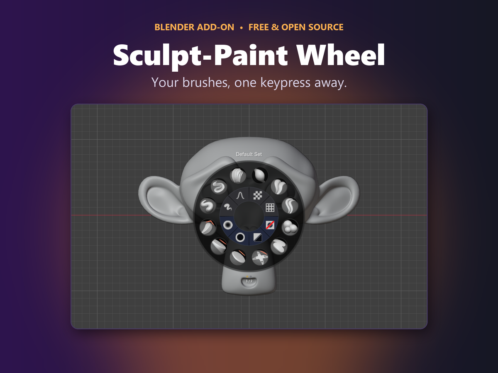
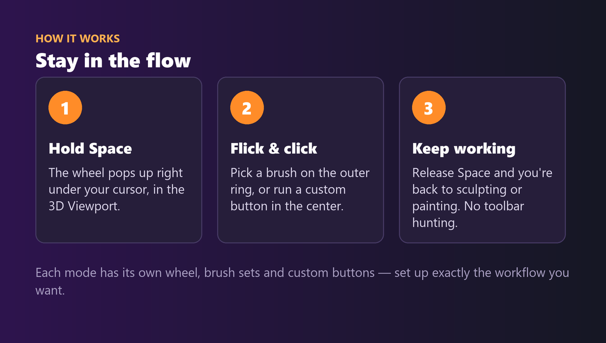
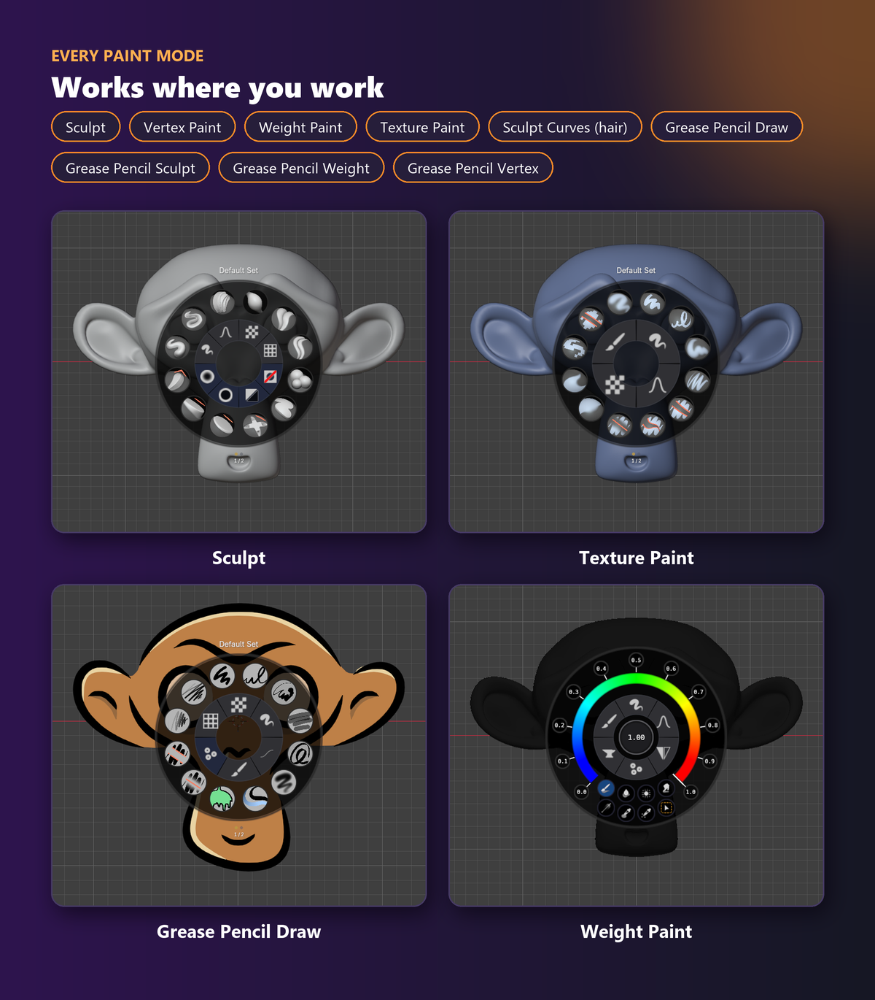

# Sculpt-Paint Wheel: User Guide

The complete guide to Sculpt-Paint Wheel **1.1.0**. For quick answers, see the [FAQ](FAQ.md).

**Contents**

1. [Getting started](#1-getting-started)
2. [The wheel at a glance](#2-the-wheel-at-a-glance)
3. [Controls](#3-controls)
4. [Modes reference](#4-modes-reference)
5. [Brush sets](#5-brush-sets)
6. [Custom buttons](#6-custom-buttons)
7. [Preferences](#7-preferences)
8. [Your data and backups](#8-your-data-and-backups)
9. [Hotkeys and keymap](#9-hotkeys-and-keymap)
10. [Troubleshooting](#10-troubleshooting)

---

## 1. Getting started

### Requirements

- **Blender 5.1 or newer.** Version 1.1.0 is tested on Blender 5.3 and 5.2.
- No internet access is needed. The add-on only reads and writes its own settings file.

### Install

1. Download `spwheel-<version>.zip` from the [latest release](https://github.com/jfran3d/Sculpt-Paint-Wheel-Reborn/releases/latest). Don't unzip it.
2. In Blender, go to **Edit › Preferences › Get Extensions**, open the **v** menu at the top right and choose **Install from Disk...**. You can also drag and drop the zip into the Blender window.
3. Check that **Sculpt-Paint Wheel** is enabled under **Edit › Preferences › Add-ons**.

### Update

Install the newer zip the same way. Your brush sets, custom buttons and preferences are kept.

### First use

1. Select a mesh and switch to **Sculpt Mode**.
2. Hover the 3D Viewport and **hold `Space`**.
3. Click a brush on the ring, then release `Space`.

The first time you use a mode, a **Default Set** of brushes and buttons is created for it.

---

## 2. The wheel at a glance

The wheel opens centered on your mouse cursor and has these parts:

| Part | What it does |
|---|---|
| **Set name** (top) | The name of the active brush set, for example *Default Set*. |
| **Brush ring** (outer ring) | The brushes of the active brush set, shown with their Blender previews. The active brush is highlighted. |
| **Custom buttons** (center pie) | The buttons of the active custom button set: popups with settings, menus and one-click operators. |
| **Page indicator** (bottom) | Shown as `1 / 2` when the set has more brushes than fit on the ring. |
| **Color picker ring** (optional) | Pick the brush color without leaving the wheel. Turn it on per brush set; see [Brush set options](#brush-set-options). |
| **Weight dial** (Weight Paint only) | Replaces the brush ring: a color-coded dial from 0.0 to 1.0 to set the brush weight in one gesture. |

---

## 3. Controls

| Input | Action |
|---|---|
| Hold `Space` | Open the wheel under the cursor |
| Move the mouse | Highlight a brush or a button |
| `Left Click` | Activate the highlighted brush, or run the highlighted button |
| `Mouse Wheel` | Switch brush pages |
| Release `Space` | Close the wheel |
| `Esc` / `Right Click` | Cancel and close the wheel |
| `Left Click` outside the wheel | Close the wheel |

Two preferences change this behavior:

- **Select on Release**: whatever is under the cursor when you release `Space` gets picked, then the wheel closes. Press, move, release: one fluid motion.
- **Keep Open**: releasing `Space` keeps the wheel open, so you can click several things. Press `Space` again to close it.

---

## 4. Modes reference

Each mode has its own wheel, its own brush sets and its own custom button sets. These are the defaults created the first time you use a mode. Brushes come from Blender's built-in **Essentials** library.

### Sculpt

- **Brushes (18):** Draw, Draw Sharp, Clay Strips, Inflate/Deflate, Crease Polish, Crease Sharp, Blob, Layer, Fill/Deepen, Flatten/Contrast, Plateau, Scrape Multiplane, Scrape/Fill, Pinch/Magnify, Grab, Grab 2D, Elastic Grab, Pose.
- **Buttons:** Stroke Settings, Falloff Settings, Texture Settings, Remesh Settings, Mask Clear, Mask Invert, Mask Sharp, Mask Smooth.

### Texture Paint

- **Brushes (15):** Paint Pixel Art, Erase Pixel Art, Airbrush, Paint Hard, Paint Hard Pressure, Paint Soft, Paint Soft Pressure, Erase Hard, Erase Hard Pressure, Erase Soft, Blur, Smear, Clone, Fill, Mask.
- **Buttons:** Advanced Brush Settings, Stroke Settings, Falloff Settings, Texture Settings.

### Vertex Paint

- **Brushes (8):** Paint Soft, Paint Soft Pressure, Paint Hard, Paint Hard Pressure, Airbrush, Blur, Average, Smear.
- **Buttons:** Stroke, Falloff, Texture, Symmetry, Paint menu, Smooth Colors.

### Weight Paint

- **Weight dial** instead of a brush ring.
- **Buttons:** Brush Settings, Stroke Settings, Falloff Settings, Mirror, Weight Options, Weights menu.

### Sculpt Curves (hair)

- **Brushes (12):** Add, Delete, Density, Comb, Slide, Pinch, Puff, Smooth, Grow/Shrink, Pull Tips, Select, and Cut (Blender 5.3+).
- **Buttons:** Brush Settings, Stroke, Falloff, Symmetry, Curves menu.

### Grease Pencil Draw

- **Brushes (13):** Pencil, Pencil Soft, Pen, Ink Pen, Ink Pen Rough, Marker Bold, Marker Chisel, Airbrush, Tint, Fill, Eraser Soft, Eraser Hard, Eraser Stroke.
- **Buttons:** Layers, Materials, Stroke, Stabilize Stroke, Advanced, Insert Blank Keyframe.

### Grease Pencil Sculpt

- **Brushes (9):** Smooth, Thickness, Strength, Randomize, Grab, Pull, Twist, Pinch, Clone.
- **Buttons:** Falloff, Auto-Masking, Multi Frame, Layers.

### Grease Pencil Weight Paint

- **Weight dial** instead of a brush ring.
- **Buttons:** Options, Falloff, Weights menu, Normalize All, Invert Weight, Smooth Weight.

### Grease Pencil Vertex Paint

- **Brushes (5):** Paint, Blur, Average, Smear, Replace.
- **Buttons:** Color, Falloff, Multi Frame, Paint menu, Reset Vertex Color, Invert Colors.

> **Blender 5.3 note:** in Sculpt, Texture, Vertex and Weight Paint, Blender moved brush falloff into the new **Shape** panel. *Falloff* buttons open that panel automatically.

---

## 5. Brush sets

Brush sets control the **outer ring**. Manage them in the 3D Viewport sidebar (`N`), in the **Wheel** tab, under **Brush Sets**. Each mode has its own brush sets, so switch to the mode first.

### Manage sets

- **Switch set:** choose it from the dropdown.
- **New set:** the button to the right of the dropdown.
- **Rename, options or remove:** the options button next to the dropdown. See [Brush set options](#brush-set-options).

### Manage brushes in a set

1. Activate a brush the usual way, from the toolbar or the asset shelf.
2. Click **+** in the Brush Sets panel to add the **active brush** to the set.
3. Select a brush in the list and click **−** to remove it, or use the arrows to reorder it. The order in the list is the order on the ring.

Any brush asset works, including your own brushes and brushes from other asset libraries.

### Brush set options

| Option | Description |
|---|---|
| **Name** | The set's name, shown at the top of the wheel. |
| **Show Color Picker** | Adds a color picker ring to the wheel, so you can change the brush color without leaving it. Available for sculpt and paint brush sets. |
| **Remove Set** | Deletes the set. |

---

## 6. Custom buttons

Custom buttons fill the **center pie**. Manage them in the sidebar's **Wheel** tab under **Custom Button Sets**. Switching, creating, renaming and removing sets works the same way as for brush sets.

### Add a button

Click **+** and fill in:

| Field | Description |
|---|---|
| **Name** | The label shown for the button. |
| **Icon Image** | An optional image file for the button's icon. |
| **Type** | **Operator** runs a Blender operator. **Popup** opens a panel or menu as a popup. |
| **Popup** | For popups only: **Menu** or **Panel**. |
| **Source** | **Preset** picks from a list of operators, menus or panels that make sense in the current mode. **Custom** lets you type any ID by hand. |

Use **−** and the arrows to remove and reorder buttons.

### Presets per mode

Each mode offers a hand-picked list of the panels, menus and operators that Blender itself shows in that mode. Some examples:

- **Sculpt:** mask filters, mask extract and slice, face sets, remesh, symmetrize, pivot options, Dyntopo and Remesh settings.
- **Grease Pencil Draw:** brush settings, stroke, stabilizer, post-processing, randomize, color mix, layers, materials, guides, keyframe tools.
- **Grease Pencil Weight Paint:** normalize, invert, smooth, add/subtract toggle.
- **Grease Pencil Vertex Paint:** set color, reset vertex color, invert, levels, hue/saturation/value, brightness/contrast.
- **Vertex Paint:** set, smooth, dirt, from weight, invert, levels, HSV, brightness/contrast.

### Custom IDs

With **Custom**, you can use anything Blender exposes:

- **Panels:** the panel ID, for example `VIEW3D_PT_tools_brush_stroke`.
- **Menus:** the menu ID, for example `VIEW3D_MT_sculpt`.
- **Operators:** the operator ID, optionally followed by `#` and its arguments, for example `paint.mask_flood_fill#mode='INVERT'`.

To find an ID, enable **Edit › Preferences › Interface › Developer Extras** and **Python Tooltips**, then hover the item in Blender's UI.

> Some operators only work in the right context. For example, multires buttons need a Multires modifier.

---

## 7. Preferences

Open **Edit › Preferences › Add-ons › Sculpt-Paint Wheel**.

### Support Development

A link to support the developer on Superhive. See [Supporting the project](#supporting-the-project).

### Save/Backup Addon Preferences

Saves your preferences, brush sets and custom buttons to disk right away. See [Your data and backups](#8-your-data-and-backups).

### Settings

| Setting | Default | Description |
|---|---|---|
| **Scale** | 1.00 | Overall size of the wheel, from 0.1 to 10. |
| **Keep Open** | Off | Releasing the hotkey doesn't close the wheel; press it again to close. |
| **Select on Release** | Off | Releasing the hotkey picks what's under the cursor, then closes the wheel. |

### Theme

Colors of the wheel: text, wheel base and outline, center pie and outline, and the idle, hovered and active colors of the buttons.

### Color Picker

| Setting | Description |
|---|---|
| **[Ring] Lock Saturation/Lightness** | The color ring only changes the hue, keeping the current saturation and lightness. |

### Weight Wheel

| Setting | Default | Description |
|---|---|---|
| **Show Markers** | On | Shows the 0.0–1.0 value markers around the weight dial. |
| **Interactable Markers** | On | Click a marker to set that exact weight. |
| **Direct Selection Weight** | On | When a selection mask is active, changing the weight also updates the weight of the selection. |

---

## 8. Your data and backups

Your preferences, brush sets and custom buttons are stored in `preferences.json`, in an `spwheel` folder inside Blender's user configuration directory.

- It's **written automatically when Blender closes**, and right away when you press **Save/Backup Addon Preferences**.
- It's **restored** after you update or reinstall the extension.
- To **back it up** or move it to another computer, copy that file.
- To **go back to the defaults** for a mode, remove its sets in the **Wheel** tab. The **Default Set** is recreated the next time Blender starts.

---

## 9. Hotkeys and keymap

The wheel is bound to **`Space`** in each supported mode's keymap: Sculpt, Sculpt Curves, Vertex Paint, Weight Paint, Image Paint, and the Grease Pencil Draw, Sculpt, Weight Paint and Vertex Paint modes.

In those modes it replaces Blender's play-animation shortcut. Playback still works from the Timeline and with `Space` in other modes.

To change the key, go to **Edit › Preferences › Keymap**, search for `Sculpt-Paint Wheel Modal`, and edit the entry in the modes you want.

---

## 10. Troubleshooting

| Problem | Try this |
|---|---|
| `Space` does nothing | Hover the **3D Viewport**, be in a **supported mode** (not Object or Edit Mode) with an **active object**, and check that no other add-on uses `Space` there. |
| A button does nothing | The operator may need a specific context, such as a Multires modifier or an existing keyframe. Check the system console for the reason. |
| *Falloff* opens a "Shape" panel | Expected on Blender 5.3; Blender moved falloff into that panel. |
| Brushes are missing from the ring | The set may have more brushes than fit: scroll the mouse wheel to change pages. |
| Something else | See the [FAQ](FAQ.md) or [open an issue](https://github.com/jfran3d/Sculpt-Paint-Wheel-Reborn/issues) with your Blender version, the mode, the steps to reproduce it, and any console error. |

---

## Supporting the project

Sculpt-Paint Wheel is **free and open source**, just like Blender. It's maintained by one independent developer, and every new Blender version needs porting, testing and fixing.

If it saves you time, you can support its development by buying it on [Superhive](https://superhivemarket.com/products/sculpt-paint-wheel). Purchases keep the add-on improving and available to everyone, including students and artists who can't afford to buy it.

You can also help by [starring the repository](https://github.com/jfran3d/Sculpt-Paint-Wheel-Reborn), [reporting bugs](https://github.com/jfran3d/Sculpt-Paint-Wheel-Reborn/issues), and sharing it with other Blender artists. Thank you! ♥
