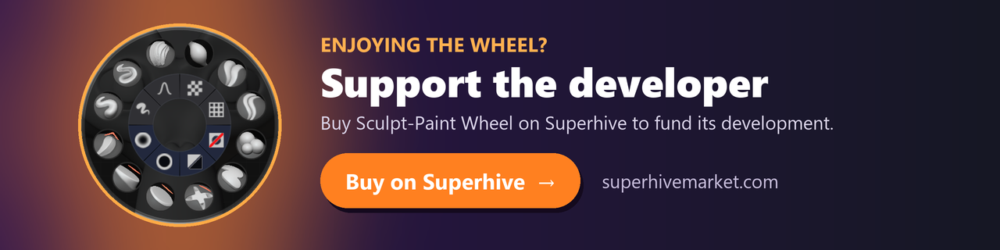
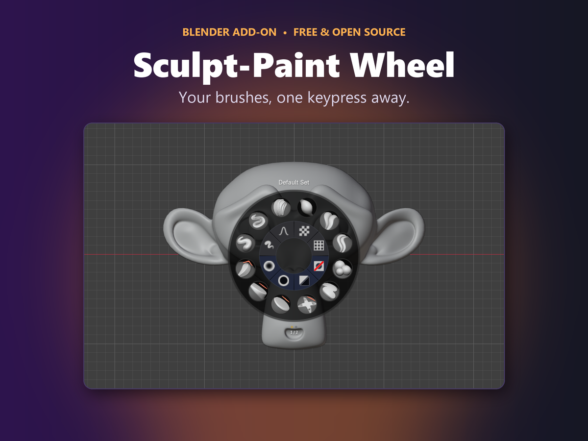
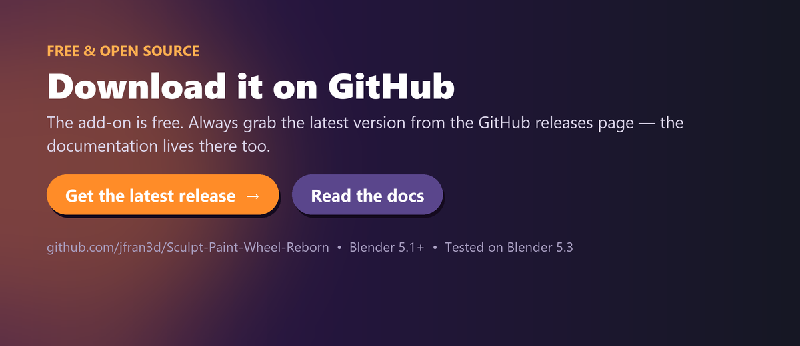
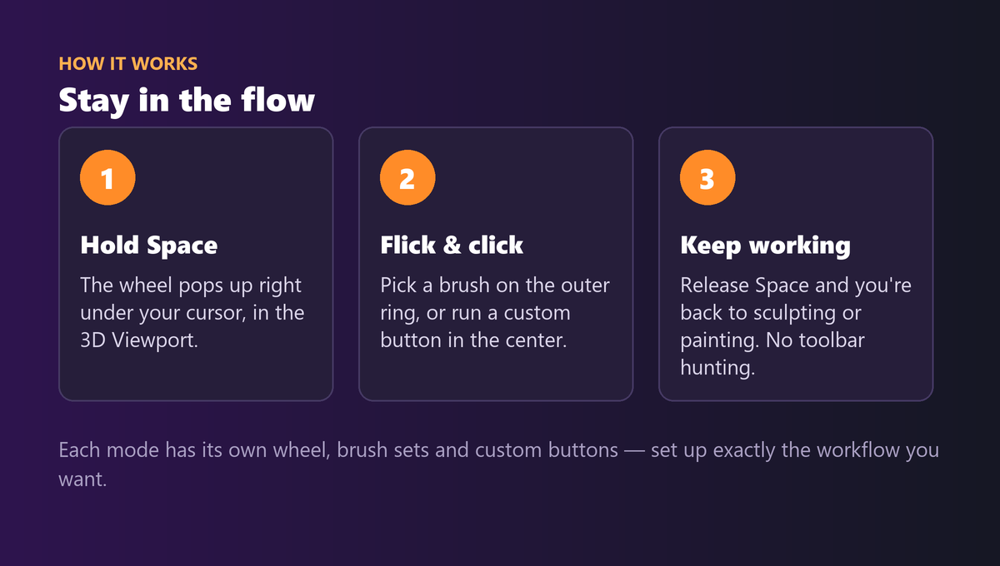
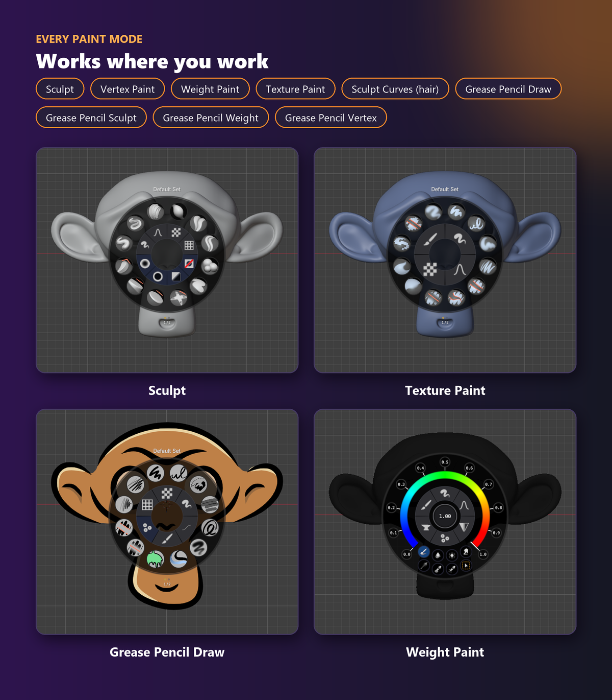
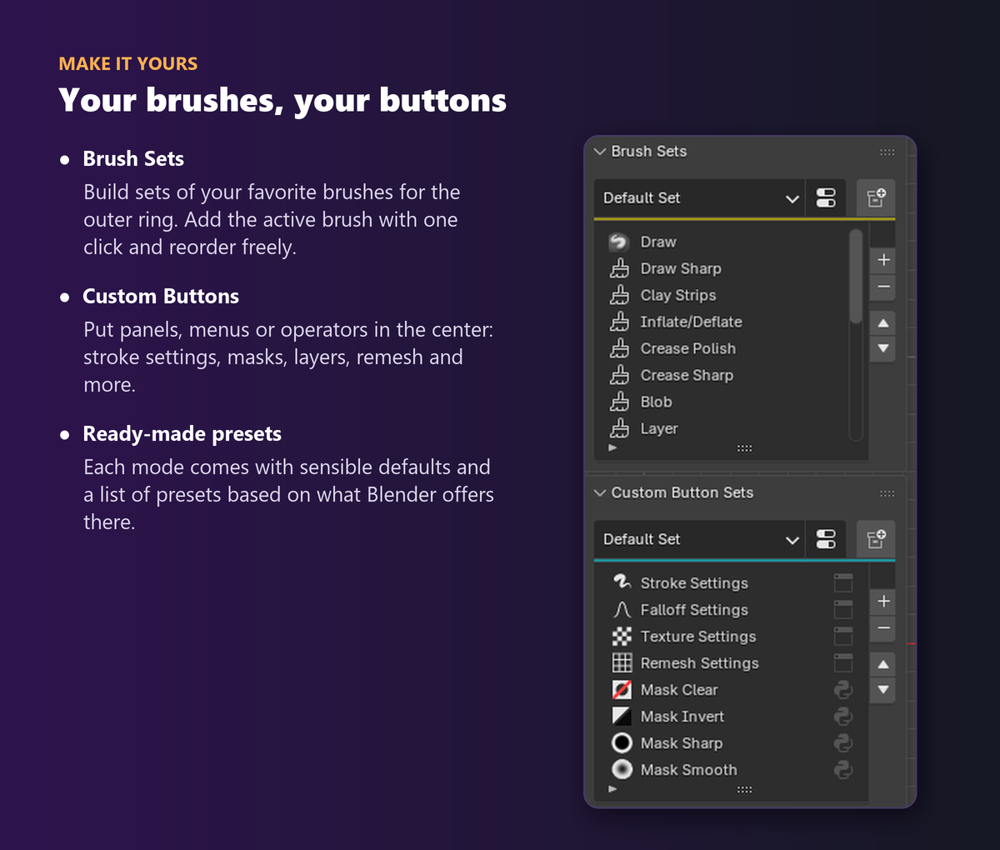
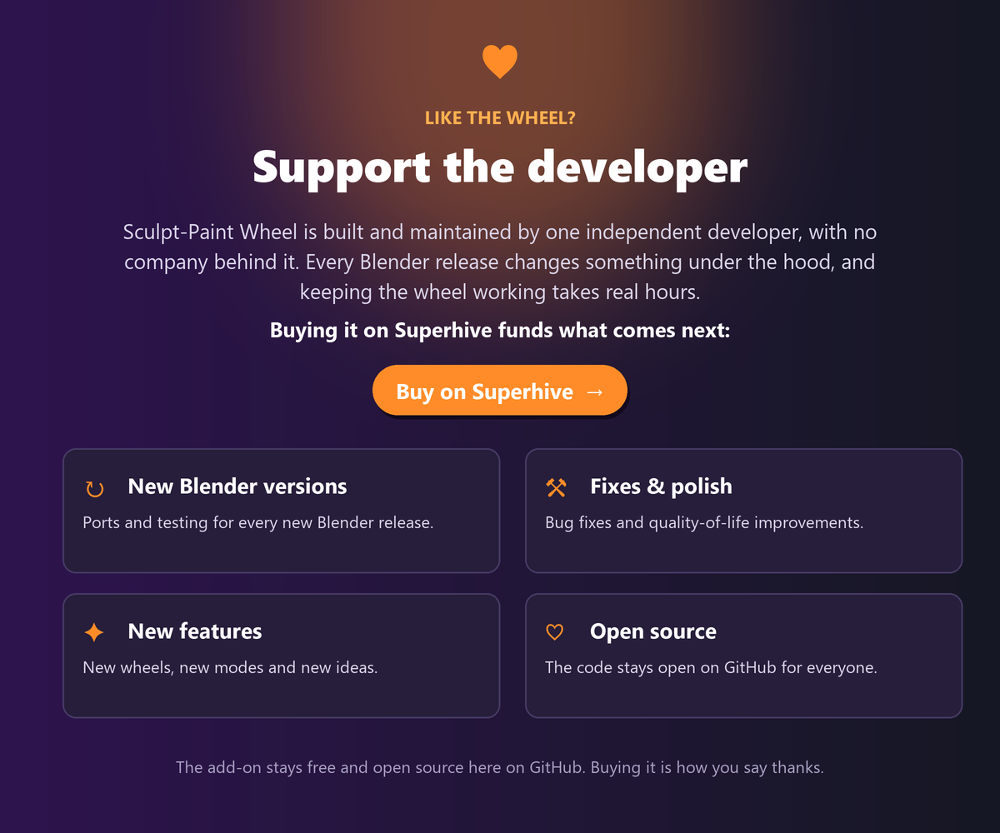
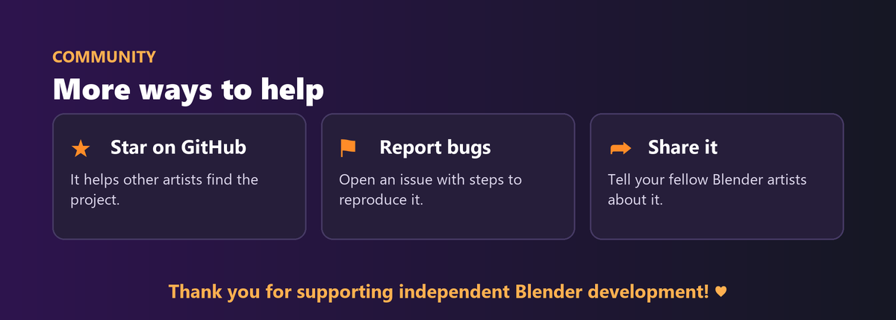

  

<h3 align="center">
  ❤️ Like this add-on? Support the developer by buying it on <a href="https://superhivemarket.com/products/sculpt-paint-wheel">Superhive</a> or <a href="https://payhip.com/b/zXfm2">Payhip</a> ❤️
</h3>

---

# SculptPaintWheel: Reborn

Original addon repo: https://github.com/jfranmatheu/Sculpt-Paint-Wheel

A Blender addon that enables a cool UI for sculpt and paint modes for a better accesibility of tools in these modes.

## To support the project you can:
- Buy the addon: https://blendermarket.com/products/sculpt-paint-wheel
- Contribute with code via PR. Please, focus in open issues if any, specially bugs.
- Contribute with bug reports via issues.

---

## Documentation

> ❓ Have a question? Check the **[FAQ](FAQ.md)**.

### Requirements

- Blender **5.1 or newer**. Tested on Blender **5.3** and 5.2.
- Built as a Blender **extension** (`blender_manifest.toml`), not a legacy add-on.

### Installation

1. Download `spwheel-<version>.zip` from the [Releases](../../releases) page. Don't unzip it.
2. In Blender: **Edit > Preferences > Get Extensions**, open the **v** menu at the top right, choose **Install from Disk...**, and pick the zip.
   You can also drag and drop the zip into the Blender window.
3. Make sure **Sculpt-Paint Wheel** is enabled under **Edit > Preferences > Add-ons**.

To update, install the newer zip the same way. Your brush sets and custom buttons are kept.

### Opening the wheel

Hover the 3D Viewport in any supported mode and **hold `Space`**.

| Action | Result |
|---|---|
| Hold `Space` | Opens the wheel under the mouse cursor |
| Move the mouse | Highlights a brush (outer ring) or a custom button (inner ring) |
| `Left Click` | Activates the hovered brush or runs the hovered button |
| `Mouse Wheel` | Switches between pages when a set has more brushes than fit on the ring (see the `1 / 2` indicator) |
| Release `Space` | Closes the wheel |
| `Esc` / `Right Click` | Cancels and closes the wheel |

The hotkey is registered in the add-on keymap for each mode. You can rebind it in **Edit > Preferences > Keymap** by searching for `Sculpt-Paint Wheel Modal`.

### Supported modes

Each mode has its own wheel, its own brush sets and its own custom button sets.

| Mode | Brush ring | Default custom buttons |
|---|---|---|
| **Sculpt** | 18 Essentials sculpt brushes | Stroke, Falloff, Texture, Remesh, Mask Clear / Invert / Sharpen / Smooth |
| **Vertex Paint** | 8 Essentials vertex brushes | Stroke, Falloff, Texture, Symmetry, Paint menu, Smooth Colors |
| **Weight Paint** | Weight markers (no brush ring) | Brush, Stroke, Falloff, Mirror, Weight Options, Weights menu |
| **Texture Paint** | 15 Essentials texture brushes | Advanced Brush Settings, Stroke, Falloff, Texture |
| **Sculpt Curves** (hair) | 12 Essentials curves brushes (`Cut` on 5.3+) | Brush Settings, Stroke, Falloff, Symmetry, Curves menu |
| **Grease Pencil Draw** | 13 Essentials draw brushes | Layers, Materials, Stroke, Stabilize Stroke, Advanced, Insert Blank Keyframe |
| **Grease Pencil Sculpt** | 9 Essentials sculpt brushes | Falloff, Auto-Masking, Multi Frame, Layers |
| **Grease Pencil Weight** | Weight markers (no brush ring) | Options, Falloff, Weights menu, Normalize All, Invert, Smooth |
| **Grease Pencil Vertex** | 5 Essentials vertex brushes | Color, Falloff, Multi Frame, Paint menu, Reset Vertex Color, Invert |

### Customizing brushes and buttons

Open the 3D Viewport sidebar (`N`) and go to the **Wheel** tab while you are in the mode you want to customize.

- **Brush Sets** controls the outer ring.
  - Pick the active set from the dropdown, or create a new one with the button next to it.
  - Use **+** to add the active brush to the set, **-** to remove the selected brush, and the arrows to reorder.
  - The options button (next to the dropdown) lets you rename or remove the set.
- **Custom Button Sets** controls the inner ring.
  - Use **+** to add a button. A button can be:
    - **Operator**: runs an operator, for example `paint.mask_flood_fill` with `mode='INVERT'`.
    - **Popup**: opens a panel or menu as a popup, for example Stroke or Falloff settings.
  - Each mode offers a list of ready-made **presets** made of the panels, menus and operators that Blender shows for that mode. You can also enter any panel, menu or operator ID by hand.
  - Remove, reorder, rename and switch sets the same way as brush sets.

The first time a mode is used, a **Default Set** is created for its brushes and its buttons. Your own changes are never overwritten by the defaults.

### Preferences

Find them in **Edit > Preferences > Add-ons > Sculpt-Paint Wheel**:

- **Scale**: overall size of the wheel.
- **Keep Open**: releasing the hotkey doesn't close the wheel. Click to pick, then press the hotkey again to close it.
- **Select on Release**: picks whatever is under the cursor when you release the hotkey, then closes the wheel. This allows a quick press-move-release workflow.
- **Theme**, **Color Picker**, **Brush Set Ring** and **Weight** settings to tune how the wheel looks and behaves.
- **Support Development**: a link to support the developer.

Your preferences, brush sets and custom buttons are saved to disk and restored when the extension is updated or reinstalled.

### Support development

Sculpt-Paint Wheel stays **free and open source** here on GitHub. If it saves you time, you can support its development by buying it on either store:

  <a href="https://superhivemarket.com/products/sculpt-paint-wheel"><b>➜ Buy on Superhive</b></a>
  &nbsp;&nbsp;•&nbsp;&nbsp;
  <a href="https://payhip.com/b/zXfm2"><b>➜ Buy on Payhip</b></a>

- ⭐ [Star the repository](https://github.com/jfran3d/Sculpt-Paint-Wheel-Reborn)
- 🐞 [Report a bug or suggest a feature](https://github.com/jfran3d/Sculpt-Paint-Wheel-Reborn/issues)
- 📣 Share it with other Blender artists

### Changelog

#### 1.1.0
- Support for **Blender 5.3** (still compatible with 5.1 / 5.2).
- New wheels for **Vertex Paint**, **Sculpt Curves** and every **Grease Pencil** paint mode (Draw, Sculpt, Weight, Vertex), each with default brushes, default buttons and preset lists.
- Grease Pencil and Sculpt Curves wheels now open with `Space`.
- Updated Sculpt presets to the Blender 5.3 operators (Mask Extract / Slice, Mask from Cavity, Hide Masked, Show All, Invert Visible).
- **Falloff** buttons open the new **Shape** panel in mesh paint modes on Blender 5.3.
- Fixed sidebar panels that failed to register on Blender 5.2+.
- Fixed a draw callback leak when the wheel failed to open.
